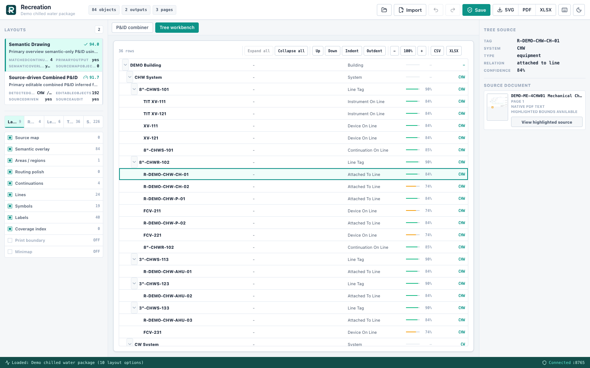
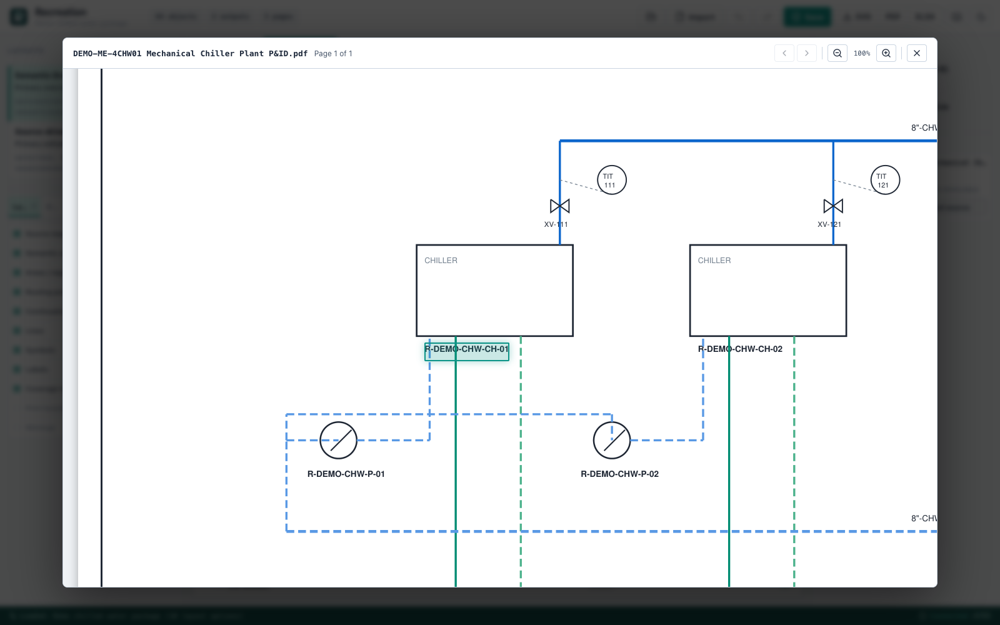

# Recreation

Recreation is an offline desktop app that reads a package of engineering drawings (P&IDs, electrical one-lines, panel schedules, cable and conduit sheets) and works out how the sheets connect. The output is a relationship graph plus an editable combined drawing, and every node links back to the page and bounding box it came from.

One system in a drawing package is usually spread across many sheets, joined by off-page "TO / FROM" callouts. Reviewing it means flipping between pages and keeping the connections in your head. I wanted a tool that does that chasing, shows the evidence for each connection, and marks the connections it isn't sure about so a person can check them.



## What it does

- Imports one or more PDFs, with a page picker so you can pull a few sheets out of a large package
- Runs a preflight pass that labels each page (one-line, panel schedule, legend, P&ID, line list, and so on) and asks you to confirm before extraction starts
- Finds off-page continuations and pairs them across sheets, with a score and the reasons behind it
- Builds relationship trees for process, electrical, and mechanical schedule pages, plus a commissioning dependency view when it finds VFDs
- Generates several editable drawing layouts and lets you edit them (move, connect, add text and regions, undo/redo, 226 SVG P&ID symbol types)
- Exports the drawing as SVG or PDF, the extracted tags and connections as an Excel workbook, and the relationship tree as CSV or XLSX

## Try it on the sample package

The drawing packages I built this against aren't mine to share, so the repo ships a made-up one. `scripts/generate-sample-package.py` uses PyMuPDF to draw three sheets into `samples/demo-package/`: a chiller plant, a chilled water distribution loop, and a cooling tower sheet. They have vector piping, equipment and instrument tags, line tags like `8"-CHWS-101`, and TO/FROM callouts that point at each other.

```bash
python3 scripts/generate-sample-package.py   # the PDFs are committed; this rebuilds them
python3 scripts/stitch-sample-smoke.py       # import, stitch, export, print a summary
```

Or start the app (below) and import the three PDFs. On this package the stitch pass finds one candidate per callout and confirms the four lines that cross sheets (chilled water supply and return, condenser water supply and return), with no pairings left at needs-review. `backend/tests/test_sample_package.py` checks the same result.

Selecting a row shows where it came from, and "View highlighted source" opens the sheet with the tag boxed:



## How it works

1. Preflight. Page text is classified into a role and a discipline with keyword rules, and likely legend pages are flagged. You confirm or correct the result before extraction runs. The confirmed review is saved with the project and copied into each drawing's metadata, but the graph builders below don't read it yet; they classify pages from the text on their own. The backend can also store a confirmed setup as a template and rank stored templates against a new package by how well their disciplines, schedule types, and legend pages overlap. The preflight dialog lists the top three, but saving or applying a template isn't in the UI yet.
2. Evidence extraction. PyMuPDF pulls positioned text spans (with rotation and color) and vector segments (with stroke color, width, and dash pattern). If a page has fewer than four usable text spans and is either vector-heavy (usually outlined text) or at least half covered by a raster image (usually a scan), it falls back to OCR: PyMuPDF's OCR text layer at 250 DPI plus a separate Tesseract sparse-text pass (`--psm 11`) on a 160 DPI render, merged and de-duplicated against the native text. On the deliberately degraded scanned stress sheets this recovers 30 of 60 tags.
3. Continuation matching. Text in the outer band of each page is checked for TO/FROM wording, sheet references, line tags, and system codes. Title blocks, revision tables, red markups, and note prose are filtered out. Candidate pairs are scored on matching line tags, reciprocal sheet references, compatible direction, and opposite page edges, then paired one-to-one. A pair needs a score of 35 to be considered and is marked confirmed at 80 or above when both ends have a known direction; the rest are kept and marked needs-review.
4. Relationship graphs. Separate builders handle P&ID pages (equipment, line tags, instruments on lines, continuations), electrical pages (one-line sources, switchgear and generator feeders, panel schedule circuits), and mechanical equipment schedules. A dependency pass then adds commissioning links, shown under "Dependency View" in the tree workbench. Right now that is one rule, a VFD to the equipment it drives and to its upstream power, and each link is tagged as inferred or needing review.
5. Layout and export. The graph and source geometry are turned into editable drawing documents colored by system, stored in SQLite, and exported from the stored data rather than from screenshots.

Two rough edges worth knowing about. Import reads each PDF twice: an older extractor builds the graph view, its review queue, and the Excel workbook, and the stitch pass above builds the drawings and relationship trees. Merging the two is still to do. And the review queue in the graph view only records decisions: accepting an item marks it resolved but doesn't change the graph.

Some rules depend on a package's naming scheme: the project code at the start of sheet numbers and tags, and the building codes on electrical equipment tags. Those values live in `backend/recreation_extractor/conventions.py`, and the defaults match the sample package.

## Where ML fits, and where it doesn't yet

The pipeline is deterministic. Text comes from the PDF text layer or Tesseract. Tags, symbol types, and relationships come from regexes, geometry, and scoring rules. There is no vision model or trained symbol detector.

`backend/recreation_extractor/llm.py` is an adapter for a local llama.cpp server that asks a model whether two tag strings refer to the same item, with JSON-schema constrained output and a string-similarity fallback. Nothing in the pipeline calls it yet, and the bundled `llama-server` is a placeholder script. If I wire it in, its job would stay narrow: reconciling ambiguous OCR text and tag variants, with the result still going through review.

## Stack

- Tauri 2 (Rust) desktop shell that starts the extraction service on a free localhost port
- React 19, TypeScript, Vite; React Flow and ELK for the graph view
- Python, FastAPI, Uvicorn, PyMuPDF, Tesseract (optional), SQLite, openpyxl, reportlab, Pillow
- PyInstaller to package the Python service as a Tauri sidecar

## Run locally

```bash
npm install
python3 -m pip install -r backend/requirements.txt
brew install tesseract   # optional, only used for the OCR fallback
```

Browser mode, with the backend in a second terminal:

```bash
PYTHONPATH=backend npm run backend:dev   # http://127.0.0.1:8765
npm run dev                              # http://127.0.0.1:1420
```

To look at the UI without a backend, open `http://127.0.0.1:1420/?demo=connected-pids`, which loads a built-in example graph.

Desktop app (needs a Rust toolchain). In dev, Tauri starts the Python backend from `./backend` itself:

```bash
npm run tauri:dev
```

To package, build the sidecar with `scripts/build-extractor-sidecar.sh`, then run `npm run tauri:build`.

## Tests

```bash
npm test              # Vitest + Testing Library
npm run backend:test  # Python unittest
npm run check         # type check, build, and both suites
```

All test data is synthetic. Most backend tests build page evidence in code. A few generate real PDFs into a temp folder and run them through extraction: the sample package above, the stress fixtures from `scripts/generate-stress-fixtures.py` (a multi-page vector P&ID package, a cable and conduit package, and scanned-style raster sheets with skew, speckle, and low contrast), and an OCR test on those scanned sheets that is skipped when Tesseract isn't installed. `tests/fixtures/stress/manifest.json` lists the expected tags and continuations.
